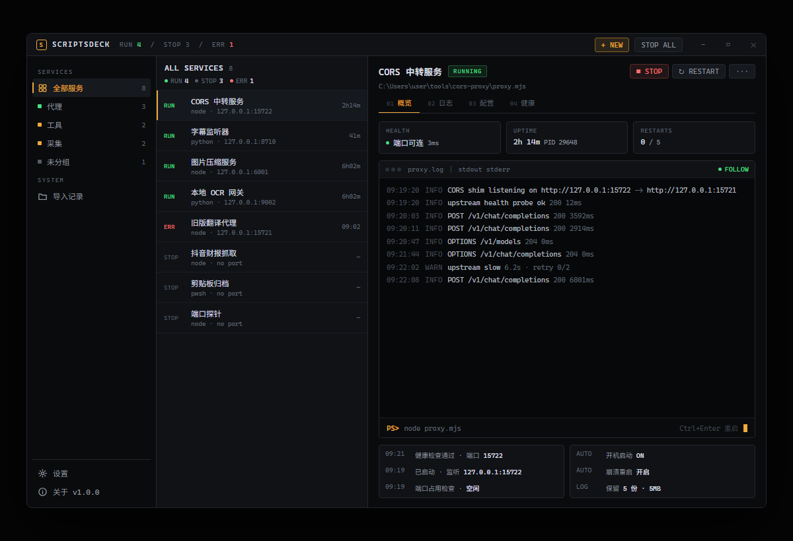
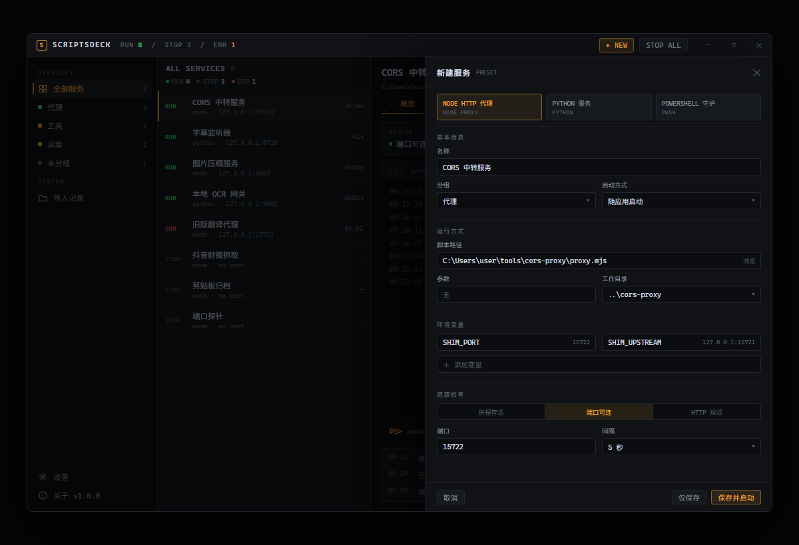

# 脚本坞 ScriptDeck

> 把散落在文件夹里的本地常驻脚本，收进一个能看状态、能一键启停、能查日志的桌面工作台。

Windows 10/11 · Electron · React · TypeScript · MIT



## 它解决什么

本地跑着的小工具通常是一段「看不见的进程」：开没开、端口占没占、为什么挂了，只能翻终端。
ScriptDeck 把每个脚本变成一条有状态、有日志、有开关的服务，关掉窗口后仍在托盘里守着。

## 功能

- **五种运行方式**：Node、Python、PowerShell、CMD、可执行文件
- **进程管理**：启动 / 停止 / 重启，停止时先温和结束，3 秒后兜底强杀整棵进程树
- **实时日志**：跟随、关键字过滤、清空、打开目录，按大小自动轮转
- **健康检查**：进程存活 / 端口可连 / HTTP 探活，间隔可配，显示延迟
- **异常处理**：退出码横幅、自动重启（不重启 / 异常时 / 总是）、指数退避与次数上限
- **目录导入**：扫描脚本，自动识别解释器、端口与环境变量，端口冲突在导入前标出
- **托盘驻留**：状态色图标、快捷启停、全部停止、开机自启
- **双主题**：深色 / 浅色 / 跟随系统
- **逐项说明**：编辑页每个配置项都有 ⓘ，悬停或键盘聚焦即可查看用途



## 安装

从 [Releases](../../releases) 下载：

| 文件 | 说明 |
| --- | --- |
| `ScriptDeck.Setup.0.1.0.exe` | 安装版，带开始菜单与卸载项 |
| `ScriptDeck-0.1.0-portable.exe` | 便携版，双击即用，不写安装目录 |

安装包未做代码签名，首次运行会被 SmartScreen 拦截，点「更多信息 → 仍要运行」即可。

## 快速开始

1. 打开应用，点「从文件夹导入」，选择存放脚本的目录
2. 在候选清单里勾选要接管的脚本，确认导入
3. 打开服务详情，按实际监听端口设置「端口可连」探活
4. 点「保存并启动」，之后关窗会缩到托盘继续运行

## 数据与隐私

- 配置：`%APPDATA%\scriptdeck\data\state.json`
- 日志：`%APPDATA%\scriptdeck\logs\<服务 id>\current.log`
- 全程本地运行，不联网、不上传、不含遥测；卸载不会删除数据目录

## 开发

```powershell
pnpm install
pnpm dev        # 开发模式
pnpm typecheck  # 类型检查
pnpm build      # 构建到 out/
pnpm dist       # 生成安装包与便携版到 release/
```

首次安装 Electron 较慢时可设置镜像：

```powershell
$env:ELECTRON_MIRROR="https://npmmirror.com/mirrors/electron/"
$env:ELECTRON_BUILDER_BINARIES_MIRROR="https://npmmirror.com/mirrors/electron-builder-binaries/"
```

## 架构

```
electron/main/     主进程：窗口、托盘、IPC、进程守护
electron/preload/  contextBridge 白名单
shared/types.ts    主进程与渲染层共享的类型与 IPC 契约
src/               React 渲染层
```

主进程按职责拆分：

- `supervisor.ts` — 状态机、重启退避、进程生命周期
- `runtime.ts` — 解释器适配器注册表
- `health.ts` — 健康探针注册表
- `scanner.ts` — 目录扫描与端口/环境变量识别
- `store.ts` — 带版本号的 JSON 持久化与迁移表
- `logs.ts` — 时间戳、轮转与尾部读取

### 扩展点

- 新增运行类型：`runtime.ts` 中调用 `registerRuntime()`
- 新增探活方式：`health.ts` 中调用 `registerProbe()`
- 新增服务字段：`shared/types.ts` 定义后在 `store.ts` 的 `MIGRATIONS` 升级版本；`Service.meta` 已预留免迁移扩展位
- 新增 IPC：在 `shared/types.ts` 的 `IPC` 与 `ScriptDeckApi` 声明，主进程注册，preload 暴露
- 新增主题：`src/styles.css` 顶部为语义变量，增加一组 `html[data-theme=...]` 即可

## 已知限制

- 进程树结束、端口归属查询依赖 Windows 的 `taskkill` / `netstat` / `tasklist`
- 安装包未签名，首次运行有 SmartScreen 提示
- v0.1.0 不含定时任务、远程管理与自动更新
- 单机单人使用，无账号体系

## English

ScriptDeck is a Windows desktop manager for long-running local scripts: start, stop and restart
processes, stream and rotate logs, run TCP/HTTP health checks, restart on failure, and keep
everything reachable from the system tray. Built with Electron, React and TypeScript.

## License

[MIT](LICENSE)
